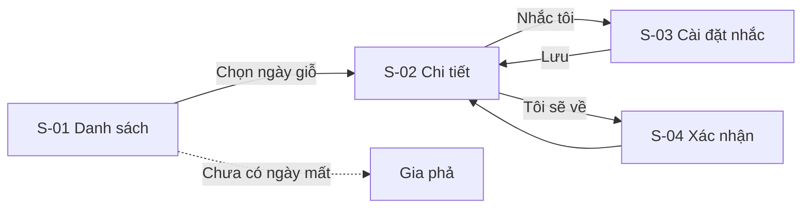

# Bàn giao: Nhắc ngày giỗ — v2 — 14/11/2026

Người liên hệ: PM An · BA Tuấn · Designer Hà
Trạng thái: Sẵn sàng code (Q-02 còn mở, không chặn ước lượng)

## 1. Tóm tắt

Thành viên nhà chung xem ngày giỗ năm nay đã đổi sang dương lịch, bật nhắc trước 7 ngày và 1 ngày, báo "Tôi sẽ về". Dành cho mọi thành viên, ưu tiên người lớn tuổi. Thành công: 60% nhà chung bật nhắc cho ít nhất 1 ngày giỗ sau 3 tháng.

- **Điểm vào:** tab Nhà chung > mục "Ngày giỗ"
- **Có trong bản này:** danh sách ngày giỗ, chi tiết, bật / tắt nhắc, "Tôi sẽ về"
- **Không có trong bản này:** ghi đóng góp, livestream, ngày giỗ người ngoài gia phả

## 2. Link

- Prototype: <link Claude Design> · Handoff bundle: <link>
- Design system: `docs/DESIGN_SYSTEM.md` (bản cỡ chữ lớn)
- PRD: [PRD.md](PRD.md) · User story: US-01…US-05 (`docs/features/nhac-ngay-gio/`) · Test user vòng 2: <link>
- Ảnh chụp: `docs/features/nhac-ngay-gio/screens/` (`S-01-empty.png`, `S-01-list.png`, `S-02-detail.png`, `S-03-reminder-on.png`…)

## 3. Thuật ngữ

| Thuật ngữ (UI / EN) | Nghĩa | Ghi chú |
| --- | --- | --- |
| Ngày giỗ (`death_anniversary`) | Ngày tưởng niệm hằng năm, theo ngày mất âm lịch | Khác "ngày mất" là ngày dương lịch lịch sử |
| Tháng thiếu | Tháng âm lịch 29 ngày | Xem BR-02 |
| Nhà chung (`family_space`) | Nhóm gia đình trong app | Đã có sẵn |
| Trưởng tộc (`role=head`) | Người quản trị nhà chung | Được sửa ngày mất |

## 4. Danh sách màn hình và user flow

| ID | Màn | Mục đích | Story | Ảnh tham chiếu |
| --- | --- | --- | --- | --- |
| S-01 | Danh sách ngày giỗ | Xem các ngày giỗ sắp tới | US-01, US-02 | `S-01-*.png` |
| S-02 | Chi tiết ngày giỗ | Xem ai sẽ về, bật nhắc | US-03, US-04 | `S-02-*.png` |
| S-03 | Cài đặt nhắc | Chọn nhắc trước 7 ngày / 1 ngày | US-03 | `S-03-*.png` |
| S-04 | Xác nhận "Tôi sẽ về" | Báo về, ghi số người đi cùng | US-05 | `S-04-*.png` |



## 5. Chi tiết từng màn

### S-03 Cài đặt nhắc

**Bố cục và hành vi**

| Khu vực | Component | Hành vi |
| --- | --- | --- |
| Header | Tiêu đề "Nhắc giỗ ông A", nút Quay lại | Quay lại không lưu nếu chưa bấm Lưu; có thay đổi thì hỏi "Bỏ thay đổi?" |
| Nội dung | 2 switch: "Trước 7 ngày", "Trước 1 ngày"; chọn giờ nhắc | Tắt cả 2 switch = tắt nhắc |
| Chân | Nút "Lưu" (primary, rộng hết màn) | Khóa khi đang gửi; thành công thì toast "Đã bật nhắc" và quay về S-02 |

**Trường dữ liệu**

| Field | UI label | Kiểu | Bắt buộc | Mặc định | Quy tắc hợp lệ | Thông báo lỗi | Ghi chú |
| --- | --- | --- | --- | --- | --- | --- | --- |
| `remind_7d` | Trước 7 ngày | boolean | Có | `true` | — | — | |
| `remind_1d` | Trước 1 ngày | boolean | Có | `true` | — | — | |
| `remind_time` | Giờ nhắc | time HH:mm | Có | `08:00` | 06:00–21:00, bước 30 phút | "Chọn giờ từ 6:00 đến 21:00" | Giờ Việt Nam (VR-02) |

**Trạng thái màn**

| Trạng thái | Hiển thị gì |
| --- | --- |
| Loading | Skeleton 2 dòng switch |
| Có dữ liệu | Switch theo cài đặt đã lưu |
| Lỗi tải | "Chưa tải được cài đặt nhắc" + Thử lại |
| Lỗi lưu | Toast "Chưa lưu được, thử lại", giữ nguyên lựa chọn |
| Thành công | Toast "Đã bật nhắc", về S-02, nút "Nhắc tôi" đổi thành "Đang nhắc" |
| Quyền thông báo bị tắt | Banner "Bật thông báo trong Cài đặt để nhận nhắc" + nút mở Cài đặt hệ thống |
| Cỡ chữ 200% | Switch xuống dòng dưới nhãn, không cắt chữ |

*(S-01, S-02, S-04 trình bày theo cùng cấu trúc trong file `screens/` của tính năng; rút gọn trong ví dụ này.)*

## 6. User story + acceptance criteria

US-01…US-05 ở `docs/features/nhac-ngay-gio/`. Ví dụ đầy đủ: [US-02-tinh-ngay-gio.md](US-02-tinh-ngay-gio.md).

## 7. Quy tắc nghiệp vụ và công thức

| ID | Quy tắc | Ví dụ có số cụ thể | Story | Ai xác nhận |
| --- | --- | --- | --- | --- |
| BR-01 | Ngày giỗ = ngày, tháng âm lịch của ngày mất, đổi sang dương lịch theo năm cần xem, múi giờ UTC+7 | Mất 15/3 âm → năm 2027 giỗ 21/04/2027 | US-02 | PM |
| BR-02 | Mất ngày 30 mà tháng đó năm nay chỉ có 29 ngày → giỗ ngày 29, hiện ghi chú | Mất 30 tháng Chạp, năm nay tháng Chạp thiếu → giỗ 29 tháng Chạp | US-02 | PM |
| BR-03 | Mất vào tháng nhuận → giỗ vào tháng thường cùng số | Mất 10/4 nhuận → giỗ 10/4 hằng năm | US-02 | 3 trưởng tộc, đã xác nhận Q-01 |
| BR-04 | Nhắc gửi lúc `remind_time` của ngày (giỗ − 7) và (giỗ − 1) | Giỗ 21/04, giờ 08:00 → nhắc 08:00 14/04 và 08:00 20/04 | US-03 | PM |
| BR-05 | Bật nhắc sau thời điểm nhắc 7 ngày → chỉ gửi nhắc còn lại | Bật ngày 18/04 → chỉ nhắc 20/04 | US-03 | PM |

**Phụ thuộc giữa các field:** tắt cả `remind_7d` và `remind_1d` → ẩn `remind_time`, nút đổi thành "Tắt nhắc".

**Công thức**

```text
ngay_gio(nam) = am_sang_duong(ngay = min(ngay_mat_am, so_ngay_thang(thang_mat_am, nam)),
                              thang = thang_mat_am (bỏ cờ nhuận), nam_am = nam)
so_nguoi_se_ve = tổng (1 + so_nguoi_di_cung) của các xác nhận "Tôi sẽ về" chưa hủy
badge "Còn x ngày" = ngay_gio - hom_nay (theo UTC+7), chỉ hiện khi 0 ≤ x ≤ 30
```

## 8. Validation và ràng buộc

| ID | Tên | Ngưỡng | Cách tính | Mức độ | Thông báo |
| --- | --- | --- | --- | --- | --- |
| VR-01 | Ngày mất âm lịch hợp lệ | ngày 1–30, tháng 1–12 | Kiểm khi đọc gia phả | Lỗi — không tính ngày giỗ cho người này | "Ngày mất chưa hợp lệ — Sửa" |
| VR-02 | Giờ nhắc | 06:00–21:00 (cấu hình được: có) | So giờ chọn | Lỗi — chặn lưu | "Chọn giờ từ 6:00 đến 21:00" |
| VR-03 | Số người đi cùng | 0–20 | Số nguyên | Lỗi — chặn lưu | "Nhập từ 0 đến 20 người" |

## 9. Dữ liệu và API đề xuất (dev quyết cuối)

**Thực thể**

| Thực thể | Trường | Kiểu | Bắt buộc | Giới hạn |
| --- | --- | --- | --- | --- |
| `reminder_setting` | `member_id`, `person_id`, `remind_7d`, `remind_1d`, `remind_time` | uuid, uuid, bool, bool, time | Có | Unique (`member_id`, `person_id`) |
| `attendance` | `member_id`, `person_id`, `year`, `companions`, `cancelled_at` | uuid, uuid, int, int, timestamp | Có trừ `cancelled_at` | `companions` 0–20 |

**Dữ liệu mẫu:** `fixtures/ngay-gio.json` (rỗng, 1 người, 12 người, tháng thiếu, tháng nhuận, chỉ có năm mất)

| Hành động | Dữ liệu vào | Dữ liệu ra | Ai được gọi | Lỗi có thể gặp |
| --- | --- | --- | --- | --- |
| Danh sách ngày giỗ năm X | `space_id`, `year` | Danh sách {người, ngày âm, ngày dương, ghi chú, đang nhắc, số người về} | Thành viên nhà chung | 403 không phải thành viên |
| Lưu cài đặt nhắc | `person_id`, 3 field ở S-03 | Cài đặt đã lưu | Thành viên, chỉ của mình | 400 VR-02, 403 |
| Báo / hủy "Tôi sẽ về" | `person_id`, `year`, `companions` | Số người về mới | Thành viên | 400 VR-03, 409 đã báo |

## 10. Trường hợp biên

- Trưởng tộc sửa ngày mất sau khi đã có người bật nhắc → tính lại lịch nhắc, không gửi nhắc theo ngày cũ.
- Người mất bị xóa khỏi gia phả → xóa cài đặt nhắc và xác nhận "Tôi sẽ về" liên quan.
- Bấm "Lưu" hoặc "Tôi sẽ về" 2 lần → chỉ 1 bản ghi (khóa nút + unique ở DB).
- Đổi giờ hệ thống / múi giờ máy sang nước khác → vẫn nhắc theo giờ Việt Nam (người ở nước ngoài: Q-02).

## 11. Yêu cầu không chức năng

- Hiệu năng: danh sách 100 người mất tải < 1 giây; đổi lịch âm làm ở server, cache theo năm.
- Thông báo: push từ server, đến được khi app không mở; sai lệch giờ nhắc ≤ 5 phút.
- Accessibility: cỡ chữ 200% không vỡ layout, nút ≥ 48dp, mọi icon có nhãn screen reader.
- Quyền riêng tư: tên và ngày mất chỉ trả cho thành viên nhà chung.
- Analytics: `gio_list_view`, `gio_remind_on` (kèm `remind_7d`, `remind_1d`), `gio_attend` — ghi khi thao tác thành công.

## 12. Câu hỏi mở

| ID | Câu hỏi | Thuộc mục | Ai trả lời | Hạn | Ảnh hưởng nếu chưa có |
| --- | --- | --- | --- | --- | --- |
| Q-01 | ~~Mất tháng nhuận thì giỗ tháng nào?~~ Đã trả lời: tháng thường (BR-03) | BR-03 | PM | 10/11 | Đã đóng |
| Q-02 | Thành viên ở nước ngoài nhận nhắc theo giờ Việt Nam hay giờ nơi ở? | BR-04 | PM | 20/11 | Không chặn; tạm theo giờ Việt Nam |

## 13. Tiêu chí nghiệm thu

- [ ] Mọi acceptance criteria của US-01…US-05 đạt
- [ ] Đủ các trạng thái ở mục 5 cho S-01…S-04
- [ ] VR-01…VR-03 có test
- [ ] Bảng đối chiếu âm – dương 2026–2030 cho 20 ngày mẫu (gồm tháng thiếu, tháng nhuận) khớp lịch Việt Nam

## 14. Lịch sử thay đổi

| Phiên bản | Ngày | Thay đổi | Lý do | Người |
| --- | --- | --- | --- | --- |
| v1 | 07/11/2026 | Bản đầu | | Tuấn |
| v2 | 14/11/2026 | Nút "Nhắc tôi" đưa ra ngoài menu "…" ở S-02; đóng Q-01, thêm BR-03 | Test user vòng 1: 3/5 không tìm thấy nút; vòng 2: 5/5 làm được | Hà, Tuấn |
