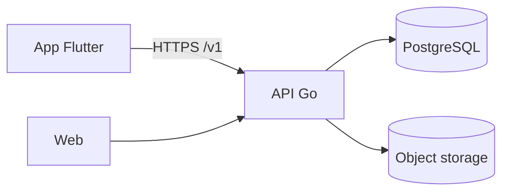

# Kiến trúc: <tên dự án>

Cập nhật: <dd/mm/yyyy> · Quyết định gốc: `docs/adr/0001-<ten>.md`

<!-- Mô tả hệ thống ĐANG LÀ, không phải lịch sử quyết định (lịch sử nằm trong ADR). Giữ ngắn; Claude đọc file này trước khi sửa code. -->

## Bối cảnh và yêu cầu chính

| Yêu cầu | Con số |
| --- | --- |
| User dự kiến năm đầu / đỉnh tải | <...> |
| Độ trễ mục tiêu (p95) | <vd < 300 ms> |
| Uptime mục tiêu | <vd 99,5%> |
| Dữ liệu | <loại, dung lượng sau 1 năm, dữ liệu cá nhân / nhạy cảm> |
| Ngân sách hạ tầng | <.../tháng> |

## Sơ đồ thành phần

| Thành phần | Công nghệ + phiên bản | Chạy ở đâu | Ghi chú |
| --- | --- | --- | --- |
| <API> | <Go 1.x, chi, sqlc> | <VPS / PaaS> | <...> |

## Module và ranh giới

| Module | Sở hữu dữ liệu (bảng) | Gọi được module nào | Thư mục |
| --- | --- | --- | --- |
| <user> | <users, sessions> | — | `internal/user` |
| <order> | <orders> | user (qua interface) | `internal/order` |

Quy tắc: module không đọc thẳng bảng của module khác. <Cách kiểm tự động: linter / test kiến trúc.>

## Luồng chính

<1–3 luồng quan trọng nhất (đăng nhập, tạo đơn…), mỗi luồng 1 sơ đồ sequence hoặc 3–5 bước.>

## Xác thực và phân quyền

- Xác thực: <JWT access + refresh / session cookie>, thời hạn <...>
- Phân quyền: <role nào, kiểm ở đâu>; mọi endpoint kiểm dữ liệu thuộc về user

## Dữ liệu

- Schema: `<đường dẫn migration>` · ERD: <link>
- Bảng sẽ lớn nhanh: <...> → <partition / archive khi nào>
- Backup: <tần suất, giữ bao lâu, đã thử khôi phục ngày ...>

## Vận hành

- Deploy: <CI/CD, môi trường dev / staging / production>, rollback: <cách>
- Log, monitoring, alert: <công cụ, ai nhận alert>
- Secret: <lưu ở đâu>

## Điểm nghẽn đã biết và khi nào nâng cấp

| Dấu hiệu | Ngưỡng | Hướng xử lý |
| --- | --- | --- |
| <query chậm ở bảng X> | <p95 > 500 ms> | <index / read replica / cache> |
