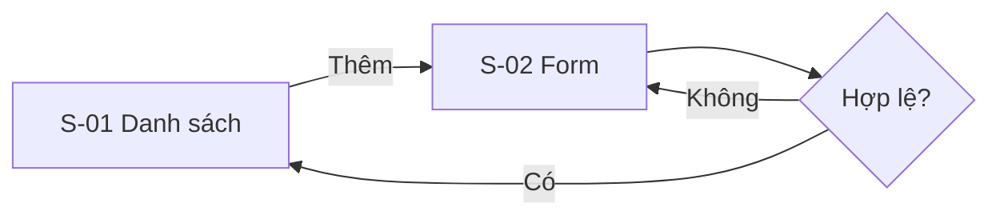

# Bàn giao: <tên tính năng> — v<1> — <dd/mm/yyyy>

<!--
Mẫu bàn giao từ PM / BA / Designer sang dev (Frontend, Backend, QA), dùng sau khi prototype đã qua test user.
- Ngôn ngữ: tiếng Việt; giữ nguyên tiếng Anh cho UI label, tên field, enum, tên component, API.
- Chỉ ghi điều đã quyết. Chỗ suy luận đánh dấu [GIẢ ĐỊNH] và đưa vào mục 12 Câu hỏi mở.
- Mục không áp dụng: ghi "N/A — <lý do>", không xóa.
- Mã định danh duy nhất trong toàn tính năng: màn S-01, story US-01, quy tắc BR-01 (riêng 1 màn: BR-S01-01),
  validation VR-01, tiêu chí AC-US01-01, câu hỏi Q-01. Tham chiếu chéo bằng mã, không chép lại nội dung.
- Tính năng nhỏ (≤ 3 màn, dưới ~800 dòng): 1 file `docs/features/<ten>.md`.
  Lớn hơn: tách thư mục `docs/features/<ten>/` gồm `00-README.md` (mục 1–4, 13, 14), `screens/S-01-<ten>.md`
  (mục 5–6 của từng màn), `rules.md` (mục 7–8), `data-api.md` (mục 9), `edge-cases-nfr.md` (mục 10–11),
  `open-questions.md` (mục 12). Đầu mỗi file có link quay về `00-README.md`.
Xóa comment này sau khi điền.
-->

Người liên hệ: PM <tên> · BA <tên> · Designer <tên>
Trạng thái: <Sẵn sàng code / Còn câu hỏi mở chặn ước lượng (mục 12)>

## 1. Tóm tắt

<3 câu: làm gì, cho ai (role), đo thành công bằng gì.>

- **Điểm vào:** <menu / đường dẫn điều hướng, vd Cài đặt > Ca làm > Thêm mẫu ca>
- **Có trong bản này:** <...>
- **Không có trong bản này:** <...>

## 2. Link

- Prototype: <link Claude Design / Figma> · Handoff bundle / frame cho Claude Code: <link>
- Design system / token: <link>
- PRD: <link> · User story: <link> · Báo cáo test user vòng cuối: <link>
- Ảnh chụp màn hình: <thư mục, tên file theo mã màn: `S-01-empty.png`, `S-01-error.png`…>

## 3. Thuật ngữ

| Thuật ngữ (UI / EN) | Nghĩa | Ghi chú |
| --- | --- | --- |
| <...> | <...> | <đừng nhầm với ...> |

## 4. Danh sách màn hình và user flow

| ID | Màn | Mục đích | Story | Ảnh tham chiếu |
| --- | --- | --- | --- | --- |
| S-01 | <...> | <...> | US-01 | <S-01-*.png> |



<Kèm nhánh lỗi: mất mạng, hết phiên, không có quyền, dữ liệu rỗng.>

## 5. Chi tiết từng màn

### S-01 <tên màn>

**Bố cục và hành vi**

| Khu vực | Component | Hành vi (bấm, chọn, bật/tắt, mở dialog…) |
| --- | --- | --- |
| <Header> | <...> | <...> |

**Trường dữ liệu** (mỗi form / biến thể một bảng)

| Field | UI label | Kiểu | Bắt buộc | Mặc định | Quy tắc hợp lệ | Thông báo lỗi | Ghi chú |
| --- | --- | --- | --- | --- | --- | --- | --- |
| <start_time> | <Giờ bắt đầu> | <time HH:mm> | Có | <08:00> | << end_time, bước 15 phút> | <"Giờ bắt đầu phải trước giờ kết thúc"> | <...> |

**Trạng thái màn**

| Trạng thái | Hiển thị gì |
| --- | --- |
| Loading | <...> |
| Có dữ liệu | <...> |
| Rỗng | <hướng dẫn bước tiếp theo, không để màn trắng> |
| Lỗi | <thông báo + nút Thử lại> |
| Thành công | <toast / chuyển màn> |
| Disabled / chỉ xem | <role nào, field nào bị khóa> |
| Không có quyền | <ẩn nút / 403 / chuyển đăng nhập> |
| Dark mode, chữ dài, cỡ chữ lớn | <N/A hoặc lưu ý> |

**Acceptance criteria:** <link tới US-xx, hoặc AC-US01-01… nếu chỉ áp dụng cho màn này.>

## 6. User story + acceptance criteria

<US-01… theo mẫu [user-story.md](user-story.md) (đủ 5 nhóm: happy path, input sai, không có quyền, dữ liệu trống, giá trị biên), hoặc link tới từng file.>

## 7. Quy tắc nghiệp vụ và công thức

| ID | Quy tắc | Ví dụ có số cụ thể | Story | Ai xác nhận |
| --- | --- | --- | --- | --- |
| BR-01 | <...> | <...> | US-01 | <PM> |

**Phụ thuộc giữa các field:** <đổi field A thì field B thế nào, vd "đổi Loại ca = Qua đêm → Giờ kết thúc cho phép nhỏ hơn Giờ bắt đầu">.

**Công thức** cho mọi con số, tổng, badge hiển thị trên UI:

```text
tong_gio = (end_time - start_time) - break_minutes / 60     # ca qua đêm: end_time + 24h
```

## 8. Validation và ràng buộc

| ID | Tên | Ngưỡng | Cách tính | Mức độ | Thông báo |
| --- | --- | --- | --- | --- | --- |
| VR-01 | <...> | <...> (cấu hình được: <có / không>) | <...> | Lỗi — chặn lưu / Cảnh báo — vẫn lưu | <...> |

## 9. Dữ liệu và API đề xuất (dev quyết cuối)

**Thực thể**

| Thực thể | Trường | Kiểu | Bắt buộc | Giới hạn |
| --- | --- | --- | --- | --- |
| <...> | <...> | <...> | <...> | <...> |

**Dữ liệu mẫu:** <link file JSON, có ca rỗng, 1 phần tử, nhiều phần tử, giá trị biên>

| Hành động | Dữ liệu vào | Dữ liệu ra | Ai được gọi | Lỗi có thể gặp |
| --- | --- | --- | --- | --- |
| <...> | <...> | <...> | <role, chỉ dữ liệu của mình?> | <...> |

## 10. Trường hợp biên

- Sửa / xóa dữ liệu đang được nơi khác dùng: <vd mẫu ca đang gán cho nhân viên>
- Hai người cùng sửa một bản ghi: <ai thắng, có báo không>
- Bấm lưu 2 lần, mất mạng giữa chừng, hết phiên khi đang nhập: <...>
- Dữ liệu bất thường: <chuỗi rất dài, ký tự đặc biệt, múi giờ, 29/02…>

## 11. Yêu cầu không chức năng

- Hiệu năng: <vd danh sách tải < 1 giây với 500 bản ghi>
- Offline: <...>
- Phân quyền và audit log: <ai làm gì cần ghi lại>
- Quyền riêng tư / dữ liệu gửi bên thứ ba: <...>
- Accessibility, responsive: <cỡ chữ lớn, screen reader, màn nhỏ nhất>
- Analytics event: <tên event — khi nào ghi>

## 12. Câu hỏi mở

| ID | Câu hỏi | Thuộc mục | Ai trả lời | Hạn | Ảnh hưởng nếu chưa có |
| --- | --- | --- | --- | --- | --- |
| Q-01 | <...> | <BR-02> | <...> | <...> | <chặn ước lượng / làm sau được> |

## 13. Tiêu chí nghiệm thu

- [ ] Mọi acceptance criteria ở mục 6 đạt
- [ ] Đủ các trạng thái ở mục 5 cho mọi màn
- [ ] Mọi validation ở mục 8 có test
- [ ] <...>

## 14. Lịch sử thay đổi

| Phiên bản | Ngày | Thay đổi | Lý do | Người |
| --- | --- | --- | --- | --- |
| v1 | <...> | Bản đầu | | <...> |

<!-- Quyết định thiết kế đổi sau test user hoặc sau buổi bàn giao: ghi 1 dòng ở đây, không chỉ nói qua chat. -->
